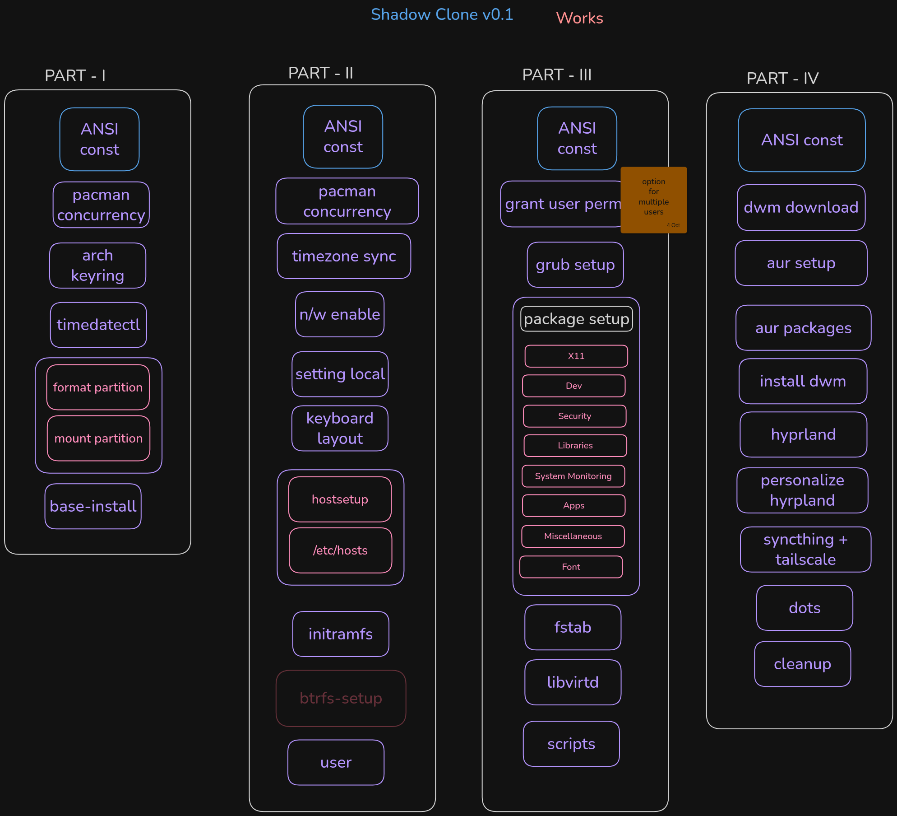

# V0.1 - WORKS  

This script is inspired by bugswriter and JaKooLit.
The dwm used is a fork of bugswriter's dwm package and
hyprland used is JaKooLit's Arch-Hyprland [ which is the most perfectly maintained hyprland repo I have come across ]

---

---

**Full Changelog**: https://github.com/ksurajsingh/shadow_clone/commits/v0.1
