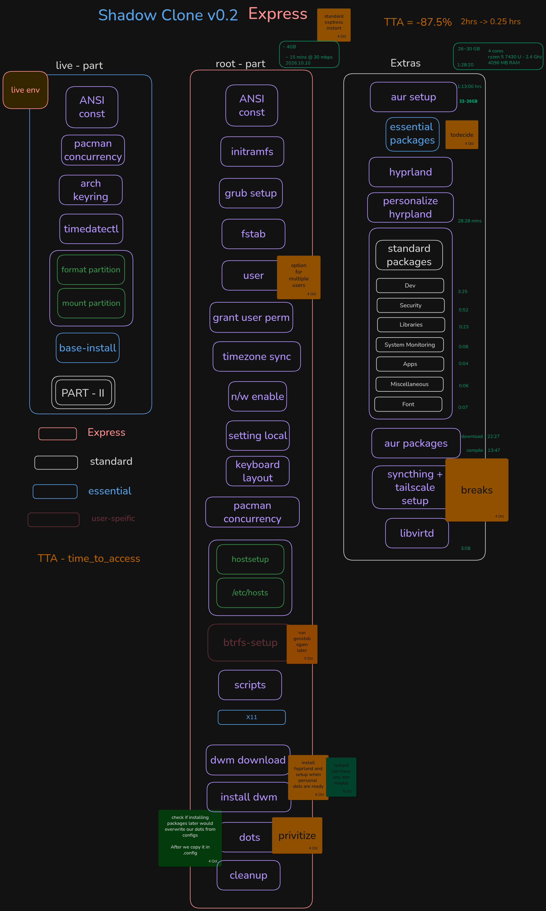

# v0.2

**We now have a TTA with v0.2.**
TTA stands for `time_to_access`.

There is a set limit time before you get to use your machine WITH a gui.
in v0.1 we had a lot of package downloads and other configurations which 
could have been running in the background WHILE you could access you system.

---

  
---

With Express comes a new structural design.
Where the heavy lifting is done in the background.

The time taken for `live` and `root` part combined is around **15 minutes**... 
and aound 4gb of disk space.

While the time taken to complete `extras-part` if around **1 and half hour**...
This includes Jakoolit's hyprland setup as well as AUR package downloads,
compilation and installation .

The total disk usage to be seen after extras-part is around **26.2-30 GB**. 

> [!CAUTION]
However I have encountered cases where 30 GB disk space, wasn't 
sufficient as well - this could be due to build-time dependencies.
SUBJECTED TO CHANGE*

**[TODO]** 
- [ ] so we need to later take care of how the heavy lifting is actually 
progressive with minimal user intervention and time required.
- [ ] bring in faster script calling it *INSTANT* where we don't even have sleep timers - assuming user's highest priority to access the system.
